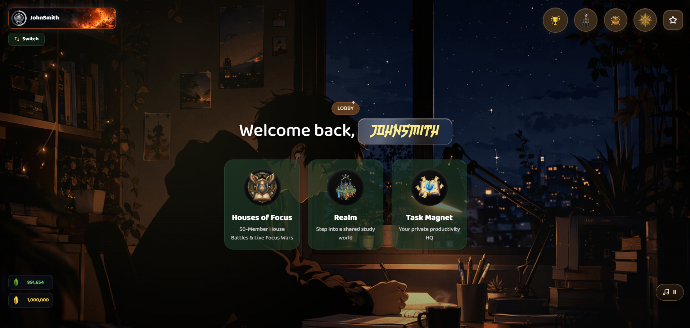

  

  # Focus Lily

  **A cozy study world in your browser.**

  Pick a desk in a grand library, watch the night roll past a train window,
  and let the timer hold you to it.

  
  
  

  
  The main reading hall

Focus Lily turns study time into a place. Instead of a timer on a plain
screen, you sit in a real room — a grand library hall, a night train, or
your own desk by the window — with a focus timer, a task board, and real
people studying quietly beside you.

**[Open Focus Lily →](https://www.focuslily.com)** — free, no install, and
you can start as a guest without an account.

## The Library

The heart of Focus Lily: a grand reading hall built for long, quiet
sessions. Warm lanterns, a red carpet, and a golden tree at the centre.
Choose a focus domain, set the timer — 25, 45, 60, 90 minutes or any
length you like — and let the room do the holding.

On mobile, the timer keeps running even when you lock the screen.

## The Night Train

Board a maroon express that rolls through snowy villages after dark. Set
your current goal, start the timer, and turn on the carriage ambience —
the world slips past the window while you work. Same timer as the library,
somewhere else to look when your eyes need a break.

  
  The night train, with the timer running

## Your desk by the window

Every session starts in the lobby: a quiet desk overlooking a city at
night. Your profile sits top-left, your gems and coins bottom-left, music
bottom-right. From here there are three doors — the Realm, your Task
Magnet, and a House to join.

  
  The lobby

> **Houses of Focus** — 50-member House battles and live Focus Wars — is coming soon.

## Task Magnet

Your private productivity HQ. Every task sticks to the board — break it
into subtasks, set due dates, and drag it along as the week moves. Capture
now, organise later.

## Study together

The realms are shared. Add friends, or sit beside strangers who want the
same quiet — no calls, no video, just heads-down co-presence. Study with
people from anywhere, at the same hour, in the same room.

## The mascot

A small cat who sits with you while you work. For company and fun —
nothing more, and that's the point.

## Getting started

1. Open [focuslily.com](https://www.focuslily.com) in any browser — no install, no account needed.
2. Pick a realm and a focus domain, then set your timer.
3. Get to work. The timer keeps counting even with your phone locked.

## FAQ

**Do I need an account?**
No. Start as a guest, and sign in later when you want your progress to
follow you between devices.

**Is it really free?**
Yes. Open the site and study.

**Does it work on my phone?**
Yes. It runs in any modern browser, and the timer keeps running when you
lock the screen.

**Do I have to talk to anyone?**
No. Study-together rooms are quiet by design — heads-down co-presence,
not conversation.

## Links

- **Web app:** https://www.focuslily.com
- **Guides:** [Focus Lily vs Forest](https://www.focuslily.com/blog/focus-lily-vs-forest) · [Focus Lily vs Flora](https://www.focuslily.com/blog/focus-lily-vs-flora) · [Pomodoro for studying](https://www.focuslily.com/blog/pomodoro-for-studying) · [Study with friends online](https://www.focuslily.com/blog/study-with-friends-online)
- **Instagram:** [@thefocuslily](https://www.instagram.com/thefocuslily/)

  Built for people who want studying to feel like a place, not a chore.

